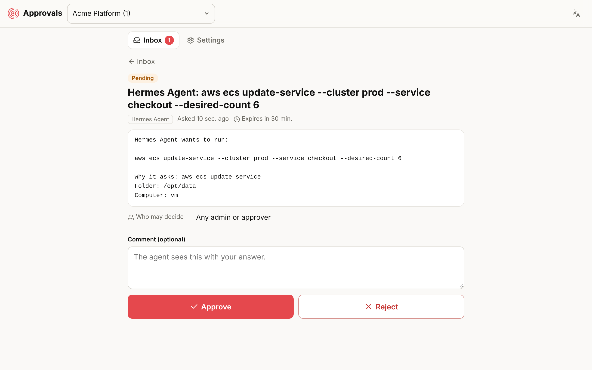
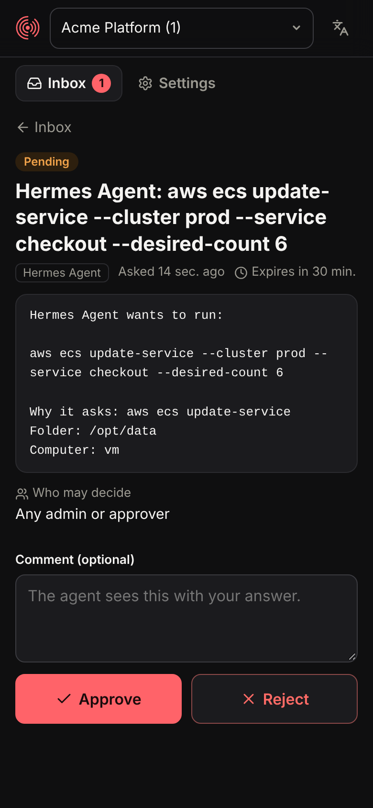
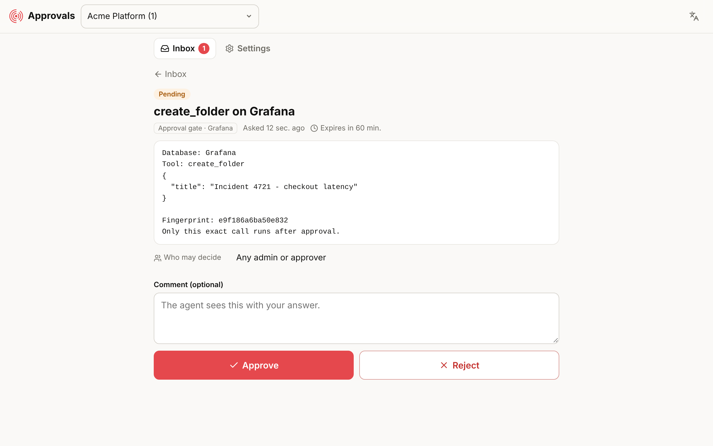

# Hermes Ops Agent

A self-hosted ops agent you can chat with from Telegram, Slack or Discord. It
investigates your Cloudflare, AWS and Google Cloud accounts, Grafana,
Prometheus, Elasticsearch/Kibana and databases. Reading always runs
straight away. **Changes wait until a second person approves them in
[Hibira Approvals](https://hibira.io/approvals).** Scaling, restarts,
deletes, deploys, cache purges and writes are all held this way.

It is the open-source [Hermes Agent](https://github.com/NousResearch/hermes-agent)
(MIT, by Nous Research) in one container, with the cloud CLIs, the
observability MCP servers and the approval wiring already set up. You bring the
model key and the credentials.

<p>


</p>

## How it works

```
 you (chat) ──► Hermes agent ──► reads:   logs, metrics, describe/list/get, queries  ──► run now
                               └► changes: scale, restart, delete, deploy, write   ──► Hibira Approvals
                                                                                        │ approver's phone / inbox
                                                     runs once, exactly as approved ◄───┘
```

- **Terminal commands** (`aws`, `gcloud`, `wrangler`, `kubectl`, `terraform`,
  `curl`, `psql`, ...) pass through a Hermes `pre_tool_call` hook
  ([`mcp-approval-gate hook hermes`](https://github.com/hibira-io/mcp-approval-gate)).
  The hook reads them the way a shell does, so `&&`, pipes, `sudo`, `bash -c`
  and `ssh host '...'` are all covered. Risky ones wait for approval and
  everything else runs.
- **MCP tools** (Grafana, Elasticsearch, Kibana, Prometheus, databases) go
  through the same gate as an MCP proxy. Read-only tools pass. Tools that
  change something wait, and SQL is classified statement by statement.
- An approval runs **that exact call once**. A rejection comes back to the
  agent with the approver's comment, plus an instruction to stop and not try
  another route.
- The hook **fails closed**: if Approvals can't be reached or nobody has
  connected the container yet, risky commands don't run.



## Quick start

```sh
mkdir hermes-ops && cd hermes-ops
curl -fsSLO https://raw.githubusercontent.com/hibira-io/hermes-ops-agent/main/docker-compose.yml
curl -fsSL -o .env https://raw.githubusercontent.com/hibira-io/hermes-ops-agent/main/.env.example
# edit .env: a model key, a chat platform (e.g. TELEGRAM_BOT_TOKEN) and the modules you want
docker compose up -d
docker compose exec agent mcp-approval-gate login --label hermes-ops-agent
```

`login` prints a link and a code. Open the link and pick your Approvals
workspace (a free one is fine). From then on, requests from this container go
to that workspace's approvers. On servers where nobody can open a link, put a
workspace token in `HIBIRA_APPROVALS_TOKEN` instead.

Then message your bot something like *"checkout p95 latency doubled since
14:00, find out why"*.

## Bring your own keys

**Model.** Any provider Hermes supports works: OpenRouter, Anthropic, OpenAI,
Gemini, Bedrock, a local vLLM or Ollama, and others. Set the provider's key.
`HERMES_PROVIDER`, `HERMES_MODEL` and `HERMES_BASE_URL` are optional. You can
also run `docker compose exec agent hermes setup` for the full wizard.

**Modules.** Each module turns on when its settings are present. Use
credentials scoped to what you want the agent to see and change.

| Module | Set | What the agent gets |
|---|---|---|
| Cloudflare | `CLOUDFLARE_API_TOKEN`, `CLOUDFLARE_ACCOUNT_ID` | `wrangler` and the Cloudflare API (`curl`) on the terminal |
| AWS | `AWS_ACCESS_KEY_ID`/`AWS_SECRET_ACCESS_KEY`/`AWS_REGION`, or `./data/.aws` with `AWS_PROFILE` | `aws` CLI v2 |
| Google Cloud | `GCP_SERVICE_ACCOUNT_JSON` (or a mounted `GOOGLE_APPLICATION_CREDENTIALS`), `CLOUDSDK_CORE_PROJECT` | `gcloud`, `gsutil`, `bq` |
| Grafana | `GRAFANA_URL`, `GRAFANA_SERVICE_ACCOUNT_TOKEN` | [Grafana MCP](https://github.com/grafana/mcp-grafana): dashboards, Loki, Tempo, alerting, incidents |
| Prometheus | `PROMETHEUS_URL` (+ auth) | [Prometheus MCP](https://github.com/pab1it0/prometheus-mcp-server): PromQL |
| Elasticsearch | `ES_URL`, `ES_API_KEY` | [Elasticsearch MCP](https://github.com/elastic/mcp-server-elasticsearch): indices, mappings, search, ES\|QL |
| Kibana | `KIBANA_URL`, `KIBANA_API_KEY` | Elastic 9.2+ Agent Builder MCP endpoint |
| Database | `DATABASE_URL` (Postgres, MySQL, MariaDB, SQL Server, SQLite) | [DBHub](https://github.com/bytebase/dbhub). Reads run and writes wait |

Turn a module off with `HIBIRA_MODULE_<NAME>=off`. Add any other MCP server
under `mcp_servers` in `./data/config.yaml`. To have it gated too, write its
command as `mcp-approval-gate --label <Name> -- <server command>`.

**Who approves.** `GATE_APPROVERS` names approver groups or emails in the
workspace (for example `sre`). If it is empty, any admin or approver can answer.

## What waits for approval

The full list is in the
[gate's README](https://github.com/hibira-io/mcp-approval-gate#coding-agents-approval-before-risky-shell-commands).
The container adds a few rules for ops work in `./data/.config/hibira/approval-hook.json`:

| Waits | Runs |
|---|---|
| `aws ... update-*/delete-*/put-*/stop-*/terminate-*`, `aws s3 rm`, `aws lambda invoke` | `aws ... describe-*/list-*/get-*`, `aws logs filter-log-events` |
| `gcloud ... create/update/delete/patch/stop` | `gcloud ... list/describe`, `gcloud logging read` |
| `wrangler deploy/rollback/delete`, `wrangler kv/r2 put/delete`, `wrangler secret put` | `wrangler tail`, `wrangler deployments list` |
| `kubectl apply/delete/scale/rollout restart`, `helm upgrade`, `terraform apply/destroy` | `kubectl get/describe/logs`, `terraform plan` |
| `curl` with POST/PUT/PATCH/DELETE or a body (except search/query endpoints such as `_search`, `/api/ds/query`) | `curl` GET, and POSTs to `_search`, `_query`, PromQL and Loki queries |
| `docker rm/stop/restart`, `systemctl stop/restart`, SQL writes | `docker ps/logs`, `systemctl status`, `SELECT` |
| Grafana, Kibana and database MCP tools that change something | read-only MCP tools |

Edit `always` / `never` in that file to fit your setup. A project file can add
rules but cannot remove them.

## Notes

- **Hermes' own confirmations stay on.** In a chat, Hermes may also ask the
  person talking to it to confirm a dangerous command. The Hibira approval comes
  first and is the second person's decision. In one-shot (`hermes chat -q`), cron
  and webhook sessions, Hermes refuses those commands by default; see
  `approvals.*` in `config.yaml` to change that.
- **The agent sees the credentials you give it.** Approval is a second pair of
  eyes, not a permission system. Give it read-mostly tokens and add write scopes
  only where you want it to act.
- **Data.** Everything the agent keeps (config, sessions, memories, skills, the
  Approvals sign-in) is in `./data`. Upgrading the image keeps it.
- **Setup runs on every start** and only touches what it manages: the hook,
  the module MCP entries, the credential passthrough list and the two skills
  (`hibira-approvals`, `ops-investigate`). The rest of `config.yaml` stays as
  you wrote it.

## Build

```sh
docker build -t hermes-ops-agent .
tests/smoke.sh hermes-ops-agent   # a real Hermes with a scripted model: risky blocked, everyday runs
```

## 中文摘要

Hermes Ops Agent 是一個自架的維運 agent 容器，以 MIT 授權的 Nous Research Hermes Agent 為基礎。可以在 Telegram、Slack 或 Discord 裡跟它對話，請它調查 Cloudflare、AWS、GCP、Grafana、Prometheus、Elasticsearch/Kibana 和資料庫。

- **查詢直接執行，調整要核准：** 查看 log、metrics、describe/list/get 和 SQL 查詢會直接跑。擴縮容、重啟、刪除、部署、清快取、寫入資料，會先送到 Hibira Approvals 等另一個人核准，核准後只執行那一次。被駁回時，agent 會收到駁回意見，並被要求停下來，不能改走別的路做同一件事。
- **自備金鑰（BYO）：** 模型 key 和雲端、監控的憑證都由你自己提供。每個模組在你設好對應的環境變數後才會啟用。
- **連線：** 執行 `docker compose exec agent mcp-approval-gate login`，打開連結、選好 Approvals 工作區就完成了。在伺服器上也可以改用 `HIBIRA_APPROVALS_TOKEN`。
- **預設 fail-closed：** 還沒連上 Approvals，或者連不到的時候，有風險的指令一律不執行。

Hibira
